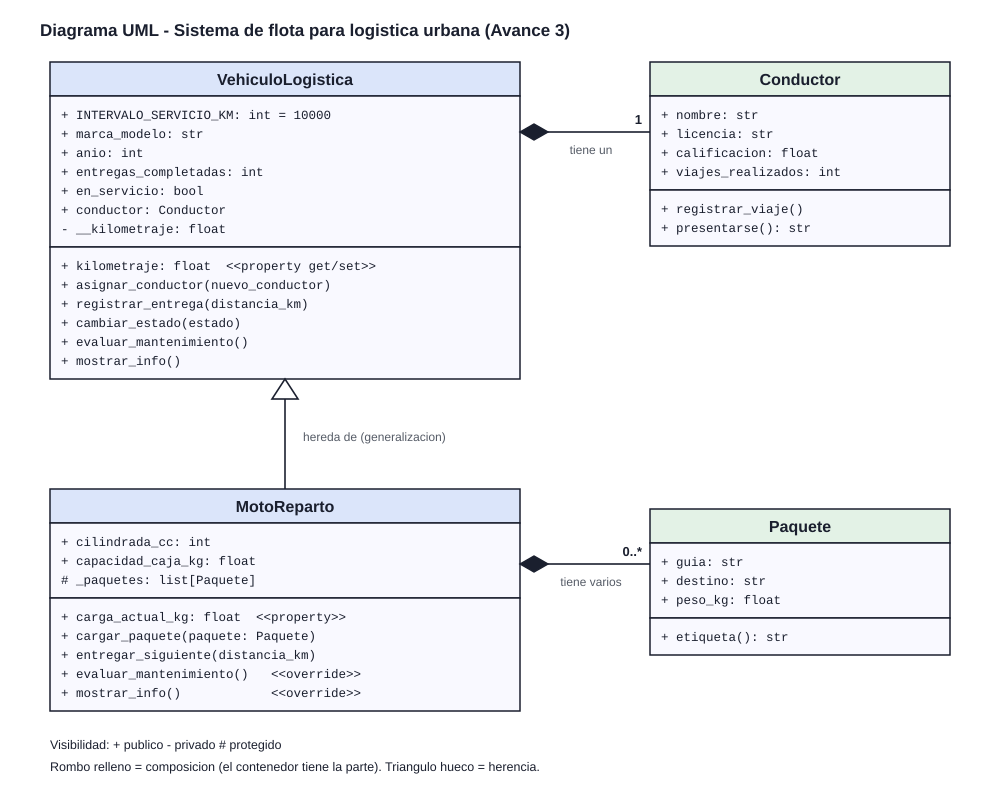

# Sistema de control de flota para logística urbana

Proyecto personal de **Programación Orientada a Objetos** — Avance 3 Final: Composición y Módulos
Alumno: Álvaro Joseph Ramírez Pulido

## De qué trata

Modela los vehículos que trabajan en plataformas de entrega a domicilio. Cada unidad lleva su propio kilometraje, entregas completadas, estado de servicio, su conductor asignado y, en el caso de las motos, los paquetes que lleva en la caja.

## Estructura del proyecto

~~~
flota-logistica-poo/
├── modelos.py               Clases: Conductor, Paquete, VehiculoLogistica, MotoReparto
├── main.py                  Importaciones, creación de objetos y pruebas
└── assets/diagrama_uml.svg  Diagrama UML actualizado
~~~

## Qué se agregó en el Avance 3

| Requisito | Cómo quedó |
|---|---|
| Composición | `VehiculoLogistica` **tiene un** `Conductor` y delega en sus métodos (`registrar_viaje()`, `presentarse()`). `MotoReparto` **tiene una** lista de objetos `Paquete`; su carga se calcula con el peso de cada paquete. |
| Clases auxiliares | `Conductor` y `Paquete`, independientes de la jerarquía de vehículos. |
| Modularización | `modelos.py` contiene solo las clases; `main.py` solo hace `from modelos import ...` y las pruebas. |
| Avances anteriores | Se conservan el encapsulamiento (`__kilometraje` con `@property`), la herencia (`MotoReparto` con `super()`) y el polimorfismo (`evaluar_mantenimiento()` y `mostrar_info()` sobrescritos). |

## Cómo ejecutarlo

~~~bash
python main.py
~~~

## Diagrama UML

Visibilidad: `+` público, `-` privado, `#` protegido. Rombo relleno = composición; triángulo hueco = herencia.
