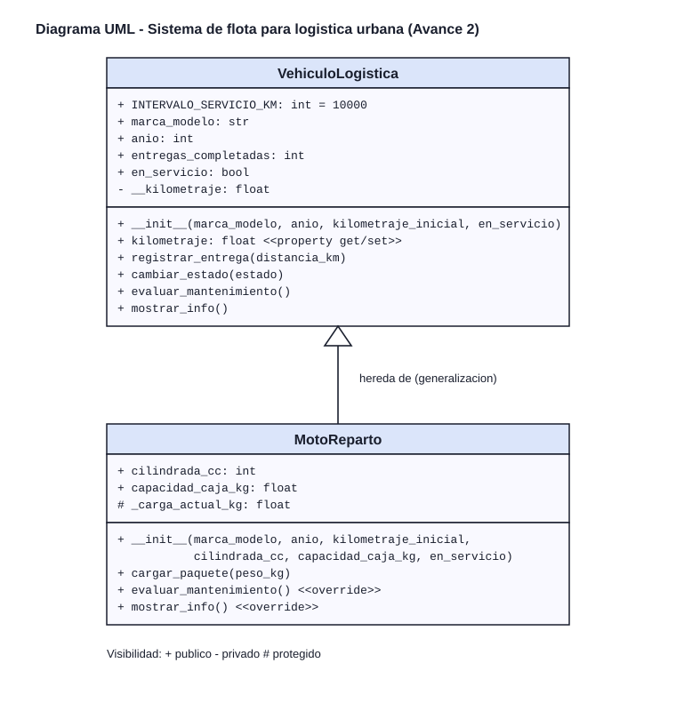

# Sistema de control de flota para logística urbana

Proyecto personal de **Programación Orientada a Objetos** — Avance 2
Alumno: Álvaro Joseph Ramírez Pulido

## De qué trata

Modela los vehículos que trabajan en plataformas de entrega a domicilio. Cada unidad lleva su propio kilometraje, entregas completadas y estado de servicio.

## Qué se agregó en el Avance 2

| Requisito | Dónde está en `main.py` |
|---|---|
| Encapsulamiento | `__kilometraje` es privado y se controla con `@property` y un setter que rechaza valores negativos o menores al actual. |
| Herencia | `MotoReparto` hereda de `VehiculoLogistica` y usa `super().__init__()`. Agrega `cilindrada_cc` y `capacidad_caja_kg`. |
| Sobrescritura (polimorfismo) | `MotoReparto` sobrescribe `evaluar_mantenimiento()` y `mostrar_info()`. |
| Métodos operativos | `registrar_entrega`, `cambiar_estado`, `evaluar_mantenimiento`, `mostrar_info` y `cargar_paquete`. |
| Pruebas | 3 objetos: 1 `VehiculoLogistica` y 2 `MotoReparto`. |

## Cómo ejecutarlo

~~~bash
python main.py
~~~

## Diagrama UML

Imagen: [assets/diagrama_uml.svg](assets/diagrama_uml.svg)

El mismo diagrama en Mermaid:

~~~mermaid
classDiagram
    class VehiculoLogistica {
        +int INTERVALO_SERVICIO_KM
        +str marca_modelo
        +int anio
        +int entregas_completadas
        +bool en_servicio
        -float __kilometraje
        +kilometraje() float
        +registrar_entrega(distancia_km)
        +cambiar_estado(estado)
        +evaluar_mantenimiento()
        +mostrar_info()
    }
    class MotoReparto {
        +int cilindrada_cc
        +float capacidad_caja_kg
        #float _carga_actual_kg
        +cargar_paquete(peso_kg)
        +evaluar_mantenimiento()
        +mostrar_info()
    }
    VehiculoLogistica <|-- MotoReparto
~~~

Visibilidad: `+` público, `-` privado, `#` protegido. La flecha va de la subclase `MotoReparto` hacia la superclase `VehiculoLogistica`.

## Estructura

~~~
main.py                    Código del sistema
assets/diagrama_uml.svg    Diagrama UML (imagen)
~~~
